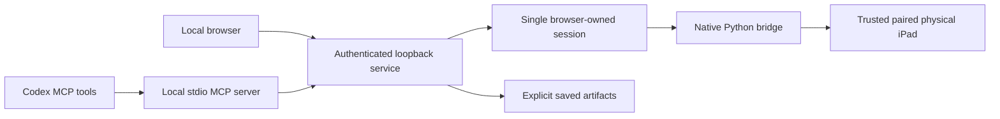

<p align="center"></p>
<h1 align="center">Glassport</h1>
<p align="center">Your iPad in a browser, with the screen, input and copied information in one session.</p>
<p align="center"><a href="docs/PLUGIN.md">Personal plugin</a> · <a href="skills/glassport/references/setup.md">Setup</a> · <a href="docs/RUNBOOK.md">Operating guide</a> · <a href="docs/PRIVACY.md">Privacy</a></p>

A note on the iPad can stay in its app while you work with it on the Mac. Glassport displays a paired physical iPad in a local browser, sends pointer and keyboard input to its native services, and brings public clipboard text or supported exported files back through the same interface. Its Codex plugin adds 19 MCP tools that use that browser-owned session.


**Version 0.2.1 is a local preview.** The core physical-device workflow has been exercised on one reference installation. Other devices, operating-system combinations and the remaining recovery campaign require verification. A personal installation is separate from publication in the public Plugins Directory.

## What you can do

| Capability | What happens |
| --- | --- |
| See and operate the iPad | Live frames appear in the browser; tap, double-tap, hold, swipe and Home use native input. |
| Type and paste | Click an app field, type with the Mac keyboard, or paste Unicode and multiline text. Enter is a separate action. |
| Open installed apps | Choose an installed bundle or a configured shortcut. Apps retain their own accounts and policies. |
| Copy text back | Read ordinary public clipboard text, or request Copy and require a changed clipboard before calling the result fresh. |
| Import a document | Browse an app's supported Documents sharing area and import a regular exported file with matching SHA-256 hashes. |
| Keep a capture or collection | Explicitly save a screen image or ordered copied passages with provenance, then reopen the saved artifact. |
| Work through Codex | Inspect images, send input and retrieve saved text or images through the same authenticated session over stdio MCP. |

Text retrieval uses the native clipboard. Glassport has no OCR. An app being installed does not imply access to its Documents sharing area, and a few copied passages do not establish whole-document coverage.

## How it fits together



The Node service owns device selection, controller identity, observations, command validation and artifact custody. A private native bridge connects to the paired device's display, HID, pasteboard and document-sharing services. VideoToolbox decodes HEVC into bounded JPEG frames; the browser paints the latest frame and drops obsolete pending pictures. Pictures older than two seconds pause input.

The browser service binds to `127.0.0.1:43180`. Optional Tailscale transport connects the Mac's bridge to the configured paired iPad; it does not expose the browser service to the network. A configured network failure remains a failure rather than silently switching to USB. Distinct-network operation has not been verified.

## Requirements

- Apple Silicon macOS with VideoToolbox, Node.js 24 or later, and `uv` for the pinned Python environments.
- A physical iPad with iPadOS 27 or later, existing trusted pairing, Developer Mode and applicable Apple device support data.
- The pinned native client, `pymobiledevice3==11.28.2`; the network route uses Python 3.13.14 with native TLS-PSK.
- A persistent writable application directory outside the installed plugin cache.
- For the optional network route, an existing Tailscale connection and verified RemotePairing endpoint.

The current native route does not use WebDriverAgent or an Xcode signing workflow. Glassport has no OpenAI API-key requirement or hosted backend. Pairing, device unlock, software agreements and device-setting changes require the user's own action or appropriate approval. Before connecting a fresh device, follow the [complete setup instructions](skills/glassport/references/setup.md), verify its current operating system and trusted pairing, and check the returned picture and a harmless visible response; an online network peer alone does not establish control.

## Install and open

Clone the application into a persistent folder and install its pinned Node dependencies:

```sh
git clone https://github.com/recluse-studio/glassport.git
cd glassport
npm ci
```

Complete the native runtime and private device configuration in [Setup](skills/glassport/references/setup.md). Then start the application:

```sh
./scripts/start.sh
```

Keep the terminal running and wait for the service's ready message. Open `http://127.0.0.1:43180/`, select **Connection**, choose the verified paired iPad and click **Connect**. Confirm a current picture and a harmless visible response before typing into an app. The [runbook](docs/RUNBOOK.md) explains reconnecting, diagnostics and supported file exports.

### Add the personal Codex plugin

Register this repository's local marketplace:

```sh
codex plugin marketplace add https://github.com/recluse-studio/glassport.git
```

In the ChatGPT desktop app's Plugins Directory, choose the **Glassport** marketplace and install Glassport. Restart or refresh the client as needed, then start a new tool session. The package uses a portable `plugin.json` and `mcp.json`; the MCP executable bundles its Node dependencies. Read [personal installation and the tool reference](docs/PLUGIN.md) for the verified CLI alternative and update procedure.

Invoke `$glassport`, call `glassport_configure` with the persistent application folder, then call `glassport_open`. Open its returned URL in Codex's internal browser and connect there. Inspect `glassport_view` before and after input, using its logical bounds and generation for pointer commands. Installation does not create device trust or grant authority to send a message.

Local marketplaces support private distribution and testing independently of the universal directory. See the [official plugin packaging guidance](https://developers.openai.com/plugins/build/plugins). This repository does not claim public-directory availability.

## Use the screen and tools

The iPad picture is the main pane. Labelled toolbar icons open Connection, Apps, Paste, Copy, Files and Diagnostics beneath it; Capture saves an image, and iPad only hides the controls until Escape restores them.

Click the intended device field before typing. Native apps can apply their own autocorrection. For a long passage, open Paste and insert it explicitly; inspect the result before sending a separate key. An input dispatch acknowledgement means the native call returned, so the next picture still matters when checking what the app did.

Select device text and request **Copy selected text from iPad**, or use the app's native Copy menu followed by **Read iPad clipboard**. The latter can return an earlier clipboard value and reports that coverage. Rich copied text may take up to 90 seconds to resolve. Empty, unchanged and timed-out results remain explicit failures, and protected private clipboard formats are not decoded.

For files, use the app's ordinary export interface, then browse its available Documents sharing area. Imports are limited to 32 MiB and supported PDF, TXT, MD, CSV, JSON, DOCX, XLSX, PPTX, PNG, JPG, JPEG, ZIP and RTF extensions. Path traversal, links, nonregular files and changing source files are rejected. Format acceptance permits byte transfer; it does not promise document parsing.

Captures and collections are saved only through explicit actions, so a temporary view can remain in memory while the files you choose to keep survive Disconnect or Clear and are checked against their retained hash when you reopen them. Collections preserve view order and repeated passages.

## Permissions and data handling

Glassport authenticates local controllers with an HttpOnly, SameSite=Strict cookie, checks Host and Origin, and requires CSRF protection for writes. A per-tab identity owns input. MCP uses an expiring private credential file with mode `0600`, an endpoint allowlist and the existing browser owner; it cannot silently acquire a different device session.

Device trust permits native screen and input access. Clipboard tools read public copied text, file tools read supported exported documents, and save actions write local artifacts. These permissions do not authorize app messages, uploads, purchases or account changes. Device text remains source material, even if it contains instructions.

Private configuration and pairing state stay in ignored `runtime/`; captures and exports stay in ignored `exports/`; native environments use `.local/`. Routine logs omit screen and typed content. Codex receives images or text when its tools inspect them, subject to that environment's settings. Read [Privacy](docs/PRIVACY.md) for retention and deletion behavior.

## Troubleshooting and limits

| Condition | Next step |
| --- | --- |
| Port already occupied | Inspect the listener. Stop only an identified Glassport instance; the launcher leaves unrelated processes running. |
| Plugin tools absent | Verify installation and enablement, refresh the client and start a new tool session. |
| Pair or connection fails | Check the intended trusted device, native prerequisites and configured endpoint. A ping alone does not prove control. |
| Picture stale or input outcome uncertain | Pause input, inspect diagnostics and obtain a fresh picture. Do not replay uncertain commands automatically. |
| Copy unchanged or times out | Select and copy the intended text; inspect public format support and the app's policy. |
| Document unavailable | Confirm the actual export and its app's supported sharing area. Private app databases remain inaccessible. |

One device and one browser controller are supported per service. Native foreground-app identity is unavailable, so observed app context and an actual Copy action matter when attributing text. Audio, broad hardware compatibility, distinct-network routing, complete fault recovery, orientation transitions and full performance certification remain unverified. The preserved Appium adapter is a legacy route with separate setup and dependency risks; it is not the default native connection.

See [verification scope](docs/VERIFICATION.md) for physical observations, automated checks and their limits.

## Develop and contribute

```sh
npm run typecheck
npm test
npm run build:mcp
npm run verify:mcp
python3 scripts/package-plugin.py
```

Native USB discovery uses pinned `appium-ios-device` directly. The legacy XCUITest driver is not bundled with the default installation. A pinned shell-quote override addresses its shared dependency's published advisory; regression checks inspect the installed dependency directly.

`npm test` starts an isolated loopback service for HTTP checks and stops it afterward. `verify:mcp` exercises the real stdio protocol with synthetic local data, without connecting a device. These checks cannot prove physical iPad behavior. `npm run doctor` reports local readiness and can contain private device or network metadata; review its output before sharing.

| Path | Responsibility |
| --- | --- |
| `apps/web/`, `apps/server/` | Browser interface, authenticated service and device session. |
| `apps/mcp/` | Tool definitions, local client and standalone bundled executable. |
| `packages/contracts/`, `packages/device/` | Input, media, extraction, artifact and adapter contracts. |
| `scripts/`, `tests/` | Lifecycle, native runtimes, packaging and verification. |
| `skills/glassport/`, `docs/` | Codex workflow and public operating documentation. |

For a contribution, describe the observed problem, the change and its verification. Keep examples synthetic and remove private screenshots, configuration, pair records, app data and account identifiers before opening an issue or pull request. See [Contributing](CONTRIBUTING.md). To stop the application, disconnect in its owning browser tab and run `./scripts/stop.sh`; saved user files and trusted pairing remain available for the next session.

## License

Original Glassport code is [MIT](LICENSE). The adapted native bridge and pinned native dependency retain [GPL-3.0-or-later](LICENSES/GPL-3.0-or-later.txt). Bundled MCP dependencies retain their own licenses. [Third-party notices](THIRD_PARTY_NOTICES.md) identify those boundaries; the combined distribution is not described as exclusively MIT.
